 

**Hi, I'm Bilal Aksoy.** A developer from Cyprus who enjoys building useful things.

[Portfolio](https://bilaltm.live) · [Discord](https://discord.com/users/603868522195714049) · [X](https://x.com/TMBilalTM) · [Email](mailto:bilpcukbilo@gmail.com)

 

### `bilal@github ~ $ whoami`

<table>
  <tr>
    <td valign="top"></td>
    <td valign="top"></td>
  </tr>
</table>

 

### `bilal@github ~ $ ./contributions.sh`

 

### `bilal@github ~ $ ls ./toolbox`

  

  

  

  

 

Plain-text profile &amp; contact

 

Currently working on **KKTCOF / DarkGiveaway**. Ask me about **PHP, JavaScript, SQL, Python, and server management**. I enjoy creating things that help others learn and automate tasks.

Website: [bilaltm.live](https://bilaltm.live) · Email: [bilpcukbilo@gmail.com](mailto:bilpcukbilo@gmail.com)

 

Built with curiosity · Animated SVGs live in this repository · Contribution data refreshes daily

<!-- Terminal layout inspired by https://www.avivashishta.com/blog/build-animated-github-profile-readme -->
